# CUDA GEMM From Scratch

This repository contains several implementations of a general matrix multiplication (GEMM) kernel in CUDA, supporting both single-precision (FP32) and mixed-precision (FP16 inputs, FP32 accumulation) operations.
It starts with a slow naive kernel and applies several optimizations to approach and surpass (at least on my GPU) the performance of NVIDIA's cuBLAS library.

The project is heavily inspired by the following blog posts:

- [How to Optimize a CUDA Matmul Kernel for cuBLAS-like Performance: a Worklog
  ](https://siboehm.com/articles/22/CUDA-MMM) by [Simon Boehm](https://siboehm.com/)
- [How To Write A Fast Matrix Multiplication From Scratch With Tensor Cores](https://alexarmbr.github.io/2024/08/10/How-To-Write-A-Fast-Matrix-Multiplication-From-Scratch-With-Tensor-Cores.html) by [Alex Armbruster](https://alexarmbr.github.io/)

## Hardware Requirements

This project supports mixed precision to leverage tensor cores.
This requires a compatible GPU with compute capability 8.0 or higher.
The code will check your GPU at runtime and produce an error if you attempt to use `--precision fp16` on incompatible hardware.
All fp32 kernels should run on older architectures.

## Building the Project

This repository uses CMake to build the main runner executable.

### 1. Prerequisites

- A C++ compiler (g++, clang++, etc.)
- The NVIDIA CUDA Toolkit (nvcc)
- CMake (version 3.18 or higher)

### 2. Build Steps

Before building, adjust `CMAKE_CUDA_ARCHITECTURES` in [`CMakeLists.txt`](./CMakeLists.txt) to fit your GPU. Then, from the root of the repository, run the following commands:

```bash
mkdir build
cd build
cmake ..
make -j
```

This will compile the project. The executable `gemm_runner` will be located in the `build/` directory.

### 3. Running a Kernel

You can run a specific kernel by passing its ID as a command-line argument:

```bash
# Run the warptiling FP32 kernel (ID 6)
./build/gemm_runner --kernel 6 --precision fp32 --repeats 1000

# Run the FP16 cuBLAS kernel (ID 0)
./build/gemm_runner --kernel 0 --precision fp16 --repeats 1000

# Run the naive WMMA FP16 kernel (ID 7)
./build/gemm_runner --kernel 7 --precision fp16 --repeats 1000
```

## FP32 Performance Overview

Performance for a 2048x2048 FP32 matrix multiplication on an NVIDIA GeForce RTX 3070.

| ID  | Kernel           |    GFLOPS | Performance vs. cuBLAS |
| --- | :--------------- | --------: | :--------------------- |
| 0   | **cuBLAS**       | `~11,613` | 100.0%                 |
| 1   | **Naive**        |  `~1,343` | 11.6%                  |
| 2   | **Tiled**        |  `~1,805` | 15.6%                  |
| 3   | **1D Coarsened** |  `~5,865` | 50.5%                  |
| 4   | **2D Coarsened** | `~10,836` | 93.3%                  |
| 5   | **Transposed**   | `~11,711` | 100.8%                 |
| 6   | **Warptiling**   | `~12,621` | 108.7%                 |

## FP16 Performance Overview

Performance for a 2048x2048 FP16 matrix multiplication on an NVIDIA GeForce RTX 3070.

| ID  | Kernel               |    GFLOPS | Performance vs. cuBLAS |
| --- | :------------------- | --------: | :--------------------- |
| 0   | **cuBLAS**           | `~39,071` | 100.0%                 |
| 7   | **Naive WMMA**       |  `~9,941` | 25.4%                  |
| 8   | **Naive MMA**        |  `~9,450` | 24.2%                  |
| 9   | **Hierarchical MMA** | `~18,153` | 46.5%                  |
| 10  | **Vectorized MMA**   | `~28,102` | 71.9%                  |
| 11  | **Memory swizzling** | `~34,133` | 87.4%                  |
| 12  | **Buffered GMEM**    | `~35,902` | 91.9%                  |
| 13  | **Unrolled SMEM**    | `~37,511` | 96.0%                  |

## Kernel Explanations

The profiling results below use `M = N = K = 2048` on an RTX 3070. Each kernel computes `C = alpha * A * B + beta * C`. The explanations focus on what changes, why it helps, and what Nsight Compute (NCU) shows.

<details>
<summary>Notation and profiling terms</summary>

- A has dimensions `M x K`, B has dimensions `K x N`, and C has dimensions `M x N`.
- `BM x BN` is the output tile computed by a block. `BK` is the number of K values processed per shared-memory tile.
- `TM x TN` is a thread's output minitile. `WM x WN` is a warp's output tile.
- Instruction counts are summed across warps.
- Requested global-load bytes count accesses to 32-byte sectors, including repeated requests. Caching determines how much traffic reaches VRAM.
- Shared-memory requests are served in units called wavefronts. A wide instruction can require several wavefronts even without bank conflicts; bank conflicts add extra wavefronts.
- Occupancy measures how many warps are active relative to the hardware limit. Active warps can still be waiting; eligible warps are ready to issue their next instruction.

</details>

### 0: [cuBLAS](./src/kernels/00_cublas.cuh)

NVIDIA's optimized matrix multiplication library, used as the performance reference.

### 1: [Naive](./src/kernels/01_naive.cuh)

Each thread computes one output element by multiplying a row of A by a column of B. Threads working on neighboring output columns read the same A value and consecutive B values, allowing their memory accesses to be combined.

The kernel executes about 537 million global-load instructions. These request about 34.38 GB of data, but caching reduces the amount read from VRAM to about 2.24 GB.

Caching helps, but the GPU still has to execute all those instructions. The largest source of stalls is `LG Throttle`: warps are waiting for room in the queue for global-memory instructions. They also wait for loaded values to arrive (`Long Scoreboard`).

The kernel takes 15.87 ms in this profiling run.

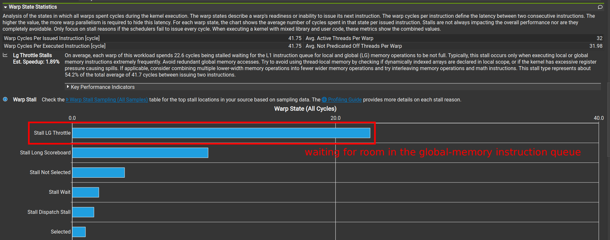

### 2: [Tiled](./src/kernels/02_tiled.cuh)

Each block computes a `16 x 16` output tile. Threads cooperate to load tiles from A and B into shared memory, then reuse those values for their calculations. They repeat this along K until the output tile is complete. Each thread still computes one output element.

Global-load instructions decrease from about 537 million to 34 million, almost eliminating `LG Throttle` stalls. However, VRAM reads stay around 2.25 GB: the naive kernel's caches were already serving most repeated requests. Tiling removes requests but adds shared-memory instructions and synchronization.

The compiler loads four A values together using `LDS.128`, reducing shared loads from 32 to 20 instructions per warp per tile. With this vectorization, runtime decreases from 15.87 ms to 12.01 ms. Replacing those vectorized loads with scalar loads using CuAssembler increases runtime to 17.78 ms—slower than naive.

Vectorizing the naive kernel directly gives 10.06 ms, also beating this tiled version. The following kernels make better use of shared memory by computing more outputs per thread and reusing values in registers.

<details>
<summary>Profiling details</summary>

Requested global-load data decreases from 34.38 GB to 4.27 GB, while VRAM reads remain almost unchanged.

The largest source of stalls is now `MIO Throttle`, associated here with issuing shared-memory instructions. Threads also wait for each other at block barriers.

For each warp and K-tile, the compiler uses four vectorized A loads and 16 scalar B loads. Across the multiplication, this produces about 335.5 million shared-load instructions.

</details>

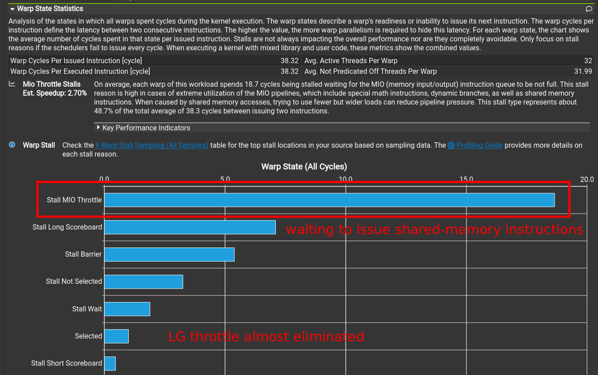

### 3: [1D Coarsened](./src/kernels/03_1D_coarsened.cuh)

Each thread now computes a vertical slice of 16 output elements. For each step along K, it loads 16 values from the shared A tile and one value from the shared B tile. That B value stays in a register and is reused for all 16 multiply-adds.

This reduces shared-load instructions from about 335.5 million to 83.9 million. There are also fewer global-memory instructions, and VRAM reads decrease from about 2.26 GB to 0.41 GB.

Computing more outputs requires more registers, reducing achieved occupancy from about 99% to 78%. The reduction in memory and instruction overhead outweighs this cost: runtime decreases from 12.01 ms to 3.57 ms, about 3.36x faster.

<details>
<summary>Profiling details</summary>

The number of multiply-adds stays the same, while total executed instructions decrease from about 1.03 billion to 425 million. Warps spend less time waiting to issue shared-memory instructions and waiting at barriers.

Register usage increases from 38 to 48 registers per thread.

</details>

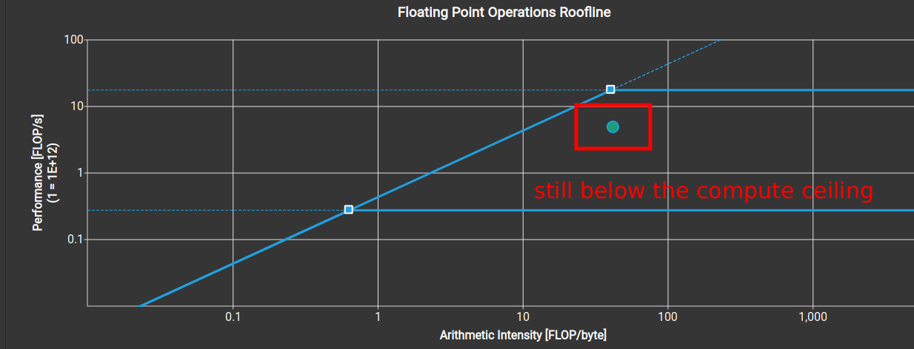

### 4: [2D Coarsened](./src/kernels/04_2D_coarsened.cuh)

Each thread now computes an `8 x 8` output minitile. For each step along K, eight A values and eight B values provide all 64 pairwise multiply-adds. Each value is reused eight times. The previous kernel needed 17 input values for 16 multiply-adds.

Shared-load instructions decrease by about 79%. Register usage increases from 48 to 128 per thread, reducing achieved occupancy from about 78% to 31%. Despite fewer active warps, runtime decreases from 3.57 ms to 1.86 ms, about 1.92x faster.

The memory accesses still need work. Shared loads have bank conflicts. In the final C loads and stores, neighboring threads access values eight floats apart, so each scalar instruction uses only 4 bytes of each requested 32-byte sector. Subsequent instructions revisit those sectors.

<details>
<summary>Profiling details</summary>

Total executed instructions decrease from about 425 million to 320 million.

The next kernel addresses the memory accesses by transposing A in shared memory and explicitly grouping global-memory accesses into vector instructions.

</details>

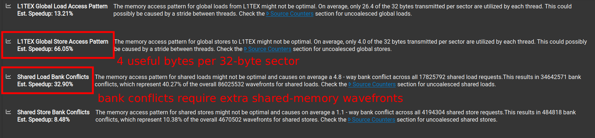

### 5: [Transposed](./src/kernels/05_transposed.cuh)

This kernel transposes A when storing it in shared memory. The A values needed for one step along K are now consecutive, allowing four to be loaded together. The compiler already vectorized some A loads before transposition, but those vectors contained values from different K steps.

Global-memory accesses also load and store four floats at once. Global-load instructions decrease from about 4.33 million to 1.08 million. Each C access now uses 16 bytes of a requested 32-byte sector instead of four.

Testing the changes separately gives 1.88 ms for vectorization alone, 2.21 ms for transposition alone, and 1.73 ms for both. All three variants use `BK = 16`.

The changes work better together because vectorized global loading also changes which A elements each thread stores. This reduces the transposed stores' bank conflicts from 16-way to 4-way. The stores remain scalar because the four values go to different rows of the transposed tile.

Adding transposition to the vectorized version improves shared loading but makes shared storing more expensive. In this configuration, the tradeoff pays off. Compared to kernel 4, runtime decreases from 1.86 ms to 1.73 ms; this comparison also includes reducing `BK` from 32 to 16.

<details>
<summary>Profiling details</summary>

Compared to vectorization alone, adding transposition reduces shared loads from 72 to 64 instructions per warp per K-tile. Total instruction count slightly increases, but the fraction of cycles with no eligible warp decreases from 37.25% to 31.68%, allowing more frequent instruction issue.

The amount of A/B data requested from global memory stays essentially unchanged. Grouping C accesses reduces repeated sector requests.

Shared-load and shared-store bank conflicts remain, leaving room to improve how work is distributed across threads.

</details>

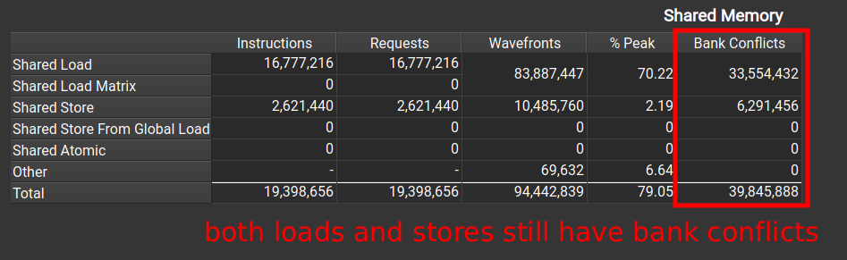

### 6: [Warptiling](./src/kernels/06_warptiling.cuh)

Each block still computes a `128 x 128` output tile, but now uses four warps instead of eight. Each warp computes a `64 x 64` tile, divided into four `64 x 16` subtiles. Each thread handles an `8 x 4` piece of every subtile, accumulating 128 outputs instead of 64.

For each K-step, a thread loads eight A values and 16 B values. Each A value is now reused for 16 multiply-adds instead of eight.

The thread mapping also changes: four neighboring lanes access four consecutive B values each. This removes the reported shared-load bank conflicts. Combined with greater register reuse, shared-load instructions decrease from about 16.8 million to 12.6 million, and wavefronts decrease from 83.9 million to 41.9 million.

Register usage increases from 107 to 167 per thread, reducing achieved occupancy from about 31% to 23%. Despite fewer active warps, more are eligible to issue instructions on average. Runtime decreases from 1.73 ms to 1.56 ms, about 10%.

<details>
<summary>Profiling details</summary>

All four subtiles are accumulated during the same traversal of K.

The new mapping also improves the final C loads and stores. Neighboring lanes fill each requested 32-byte sector, compared to using half of it in kernel 5. Requested C load bytes decrease from about 33.6 MB to 16.8 MB.

This configuration reduces `BK` from 16 to 8. The changed cooperative loading pattern reduces transposed A store conflicts from 4-way to 2-way. Shared-store wavefronts decrease from about 10.5 million to 6.3 million.

</details>

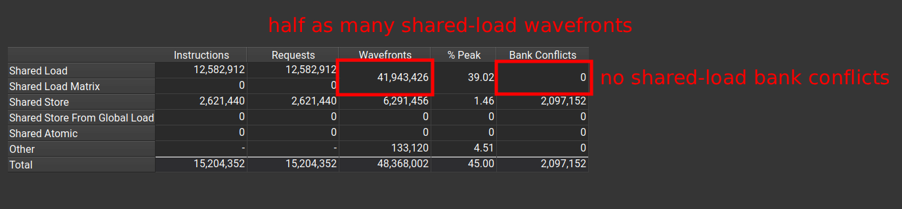

The following roofline plot compares cuBLAS and the six custom kernels for this problem size and GPU:

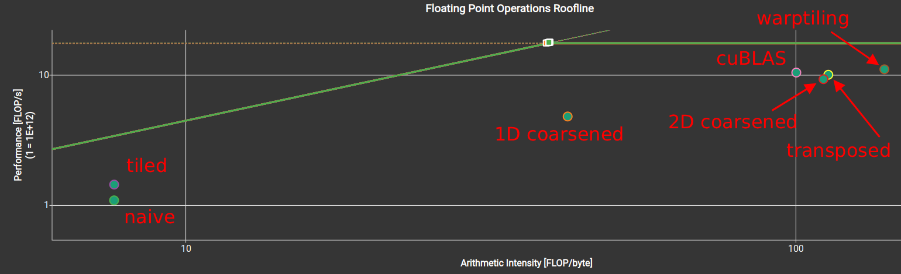

### 7: [Naive WMMA](./src/kernels/07_naive_wmma.cuh)

This is the first custom kernel to use tensor cores. A and B contain FP16 values, while accumulation and output remain FP32. The kernel uses CUDA's WMMA (warp matrix multiply accumulate) API.

Each block contains one warp, which computes a `16 x 16` output tile. The warp loads `16 x 16` tiles from A and B directly from global memory, calls `wmma::mma_sync`, and advances 16 elements along K.

All 32 threads cooperate. Matrix fragments are distributed across their registers, with WMMA handling the layout. After accumulation, the threads apply alpha and beta and store the output.

The kernel achieves almost 10 TFLOPS in the benchmark. Comparisons with earlier kernels now also include the change to FP16 inputs.

There is no shared-memory staging or larger output tile to increase reuse. NCU shows substantial waiting for global loads (`Long Scoreboard`), with no eligible warp in about 89% of scheduler cycles.

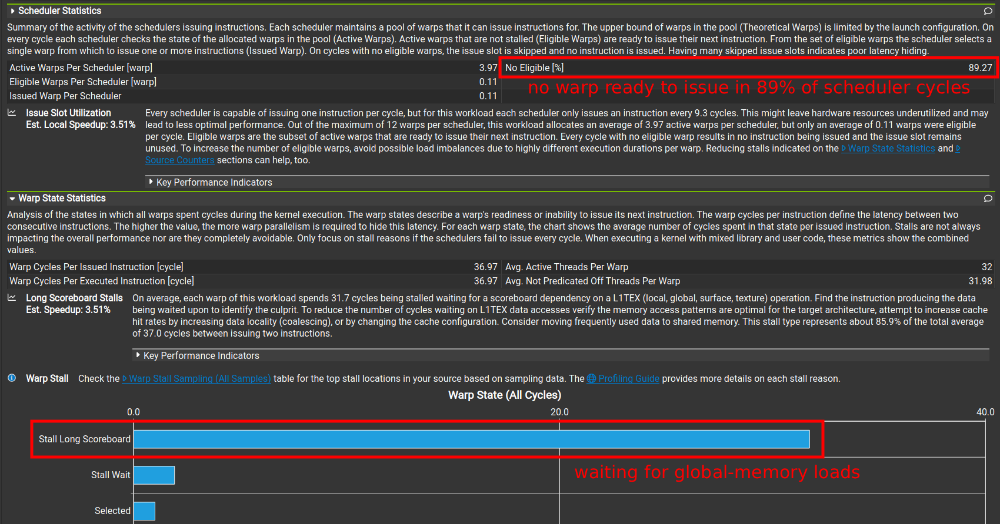

### 8: [Naive MMA](./src/kernels/08_naive_mma.cuh)

This kernel uses explicit PTX instructions. Each warp-wide `mma.sync.aligned.m16n8k8` operation multiplies a `16 x 8` A fragment by an `8 x 8` B fragment and accumulates into a `16 x 8` output fragment.

Each block still contains one warp, but computes a larger `64 x 32` output tile. Threads load a `64 x 8` A tile and an `8 x 32` B tile into shared memory. These supply 16 MMA operations per step of eight elements along K. `ldmatrix` loads the fragments into the required register layout.

However, the loop reloads both input fragments for every MMA operation. An A fragment is loaded again for each output fragment along N, and a B fragment is loaded again for each along M.

NCU confirms 16.8 million matrix-load instructions. They require 50.3 million wavefronts, including 25.2 million additional wavefronts from bank conflicts. The next kernel removes most repeated fragment loads.

<details>
<summary>Profiling details</summary>

Each thread holds four accumulator values per output fragment, giving 64 accumulated outputs per thread.

The larger output tile and shared-memory reuse reduce requested global-load data from about 4.31 GB to 1.36 GB. However, total executed instructions increase from about 62.8 million to 249.3 million. Reducing global-memory requests comes with substantial instruction overhead in this implementation.

The measured matrix-load count matches two `ldmatrix` instructions per MMA operation.

</details>

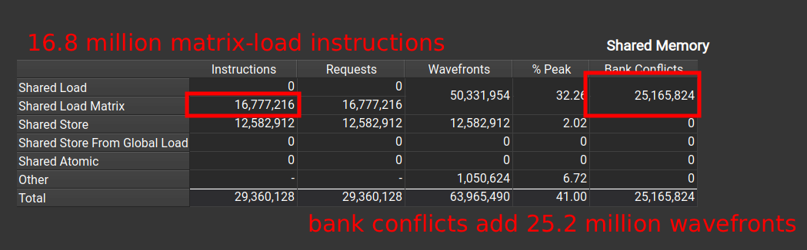

### 9: [Hierarchical MMA](./src/kernels/09_hierarchical_mma.cuh)

Each block now contains four warps and computes a `128 x 128` output tile. Each warp handles a `128 x 32` part. Threads cooperate to load the input tiles into shared memory, where the same A tile serves all four warps.

For each step of eight elements along K, a warp loads eight A fragments and four B fragments into registers, then computes all 32 pairs. Each A fragment is reused four times, and each B fragment eight times. This requires 12 `ldmatrix` instructions, compared to 64 for the same arithmetic in the previous kernel.

Matrix-load instructions decrease from about 16.8 million to 3.15 million, an 81% reduction. Shared-load wavefronts decrease from 50.3 million to 12.6 million. B loads still have bank conflicts, but happen much less often.

The larger tiles require more registers, reducing achieved occupancy from about 30% to 23%. With the chosen configuration, the kernel runs roughly twice as fast as the previous version in the benchmark.

<details>
<summary>Profiling details</summary>

The larger blocktile reduces repeated global loads. Requested global-load data decreases from about 1.36 GB to 0.44 GB, while total executed instructions decrease from 249.3 million to 92.9 million.

Each thread now accumulates 128 outputs instead of 64. Register usage increases from 125 to 165 per thread.

Blocktile and warptile dimensions can be tuned separately to balance input reuse against register usage.

</details>

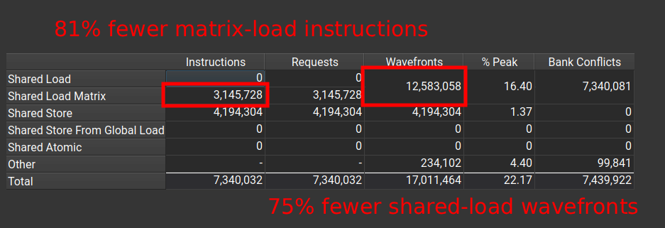

### 10: [Vectorized MMA](./src/kernels/10_vectorized_mma.cuh)

This kernel keeps the same tile sizes and MMA calculations but groups memory accesses into wider instructions. Each thread copies eight FP16 values using a 128-bit global load followed by a 128-bit shared store. The code uses `float4` to copy these 16 bytes without converting the FP16 values.

This reduces A/B global-load and shared-store instructions eightfold. The epilogue uses `float2` to load and store two neighboring FP32 outputs at once, halving the C instruction counts and filling the requested sectors.

Including the epilogue, global-load instructions decrease from about 4.33 million to 0.590 million. Vectorization also reduces addressing and loop overhead: total executed instructions decrease from 92.9 million to 27.3 million, a 71% reduction.

This gives a substantial speedup in the benchmark. Shared-memory fragment loading remains unchanged, including the B bank conflicts addressed by the next kernel.

<details>
<summary>Profiling details</summary>

For A and B, global-load instructions decrease from about 4.19 million to 0.524 million. Shared-store instructions decrease by the same amount.

Requested C load bytes decrease from 33.6 MB to 16.8 MB; requested C store bytes decrease by the same amount. Total requested global-load data changes only slightly, from about 0.435 GB to 0.419 GB. The main benefit is executing fewer instructions.

Register usage changes from 165 to 167 per thread, and achieved occupancy remains about 23%.

Shared-memory matrix loads remain at about 3.15 million instructions and 12.6 million wavefronts.

</details>

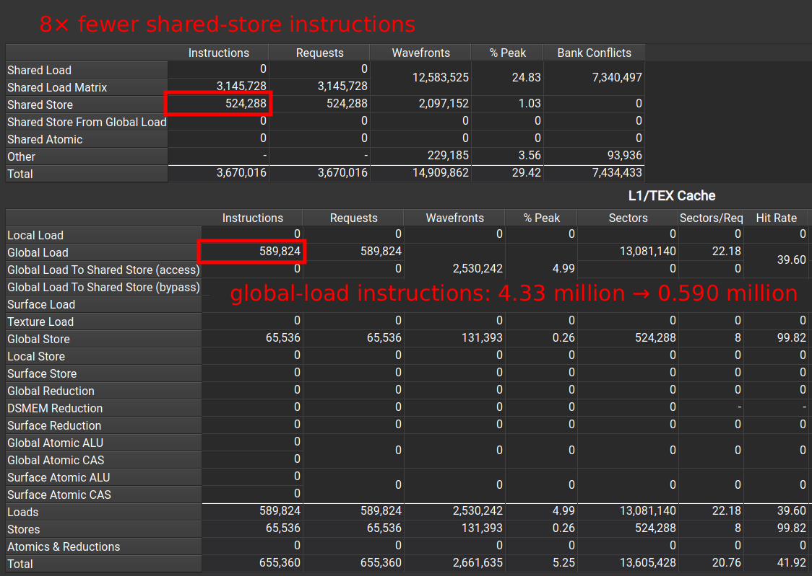

### 11: [Memory swizzling](./src/kernels/11_memory_swizzling.cuh)

This kernel rearranges values in shared memory so that fragment loads spread their accesses across the banks.

Consider an `8 x 8` FP16 fragment from B. Each row occupies 16 bytes across four banks. With the ordinary row-major layout used here, all eight rows access the same four banks, requiring those banks to be accessed eight times.

Swizzling uses an XOR with row-index bits to rearrange groups of eight FP16 values. The eight rows then access different groups of four banks, covering all 32 banks. Each group stays contiguous and aligned for vectorized copies. Applying the same mapping during stores and loads preserves the logical matrix values.

Both A and B use this layout. Shared-load wavefronts decrease from about 12.6 million to 4.22 million, and reported shared-load bank conflicts decrease by 99.6%.

The configuration also changes: warptiles become `64 x 64`, and `BK` increases from 8 to 64. Shared-memory usage grows from 4 KiB to 32 KiB per block. The performance change therefore includes swizzling and tile tuning.

<details>
<summary>Profiling details</summary>

Each block still computes a `128 x 128` output tile using four warps. Warptiles change from `128 x 32` to `64 x 64`, while `WK` increases from 8 to 16. Each warp loads fragments for two MMA steps along K at a time.

Matrix-load instructions remain at about 3.15 million. Reported shared-load bank conflicts decrease from about 7.34 million to 29,000.

Increasing `BK` reduces tile iterations and block-wide synchronizations eightfold. It also lets neighboring threads load longer contiguous sections of A rows, filling requested sectors. Requested global-load data decreases from about 0.419 GB to 0.285 GB.

Total executed instructions increase from about 27.3 million to 32.7 million. Register usage stays at 167 per thread. The kernel also switches to explicit shared-memory offsets for `ldmatrix`, changing the address calculations.

</details>

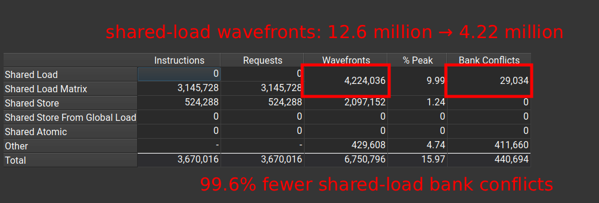

### 12: [Buffered GMEM](./src/kernels/12_buffered_gmem.cuh)

This kernel starts loading the next input tiles while calculating with the current ones. The current tiles stay in shared memory, while temporary registers hold the incoming values. This gives the GPU independent calculations to execute while global loads are in progress.

The first tiles are loaded before the loop. Each iteration issues loads for the next tiles, computes using the current tiles, then synchronizes before overwriting shared memory with the buffered values. Another synchronization makes the new tiles available. The final tiles are computed without loading another set.

There is still only one shared-memory buffer per input matrix. The overlap comes from delaying the use of the global-load results until after the current computation.

`Long Scoreboard` stalls decrease from about 2.2 to 0.7 cycles per issued warp instruction, consistent with hiding more load latency. However, this comparison also changes `BK` from 64 to 32 and `WK` from 16 to 32.

Register usage increases from 167 to 217 per thread, reducing achieved occupancy from about 21.6% to 15.6%.

<details>
<summary>Profiling details</summary>

With `BK = WK = 32`, each warp loads fragments for all four MMA steps along the current tile's K dimension before using them.

Shared-memory usage halves from 32 KiB to 16 KiB per block, while tile iterations double. The additional registers reduce the maximum number of resident blocks per SM from three to two.

Global-load instructions remain at about 0.590 million, and VRAM reads stay around 72 MB. Total executed instructions decrease from about 32.7 million to 27.9 million.

These results include both the earlier global loads and the changed tile configuration.

</details>

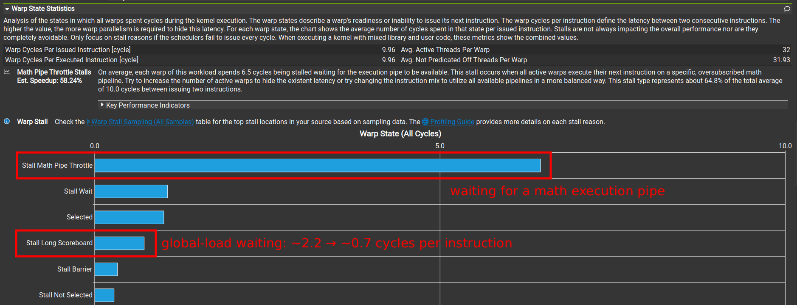

### 13: [Unrolled SMEM](./src/kernels/13_unrolled_smem.cuh)

This kernel keeps the previous tile sizes, swizzling, and global-memory buffering. It replaces the fragment-loading loops with manually written sequences using `ldmatrix.x4`, which loads four `8 x 8` FP16 matrices per warp instruction.

For each warp and tile of 32 K values, matrix-load instructions decrease from 48 to 16. Across the multiplication, this reduces the count from about 3.15 million to 1.05 million, a 67% reduction.

Shared-load wavefronts remain about 4.19 million, with no reported bank conflicts. The same values are loaded, but each instruction handles more of them.

The functions also simplify address calculations by updating an initial swizzled address with fixed offsets and XOR operations. Together, these changes reduce total executed instructions from about 27.9 million to 14.0 million, a 50% reduction.

The load sequences are specialized for this tile configuration. Changing the fragment counts requires updating them.

<details>
<summary>Profiling details</summary>

For A, one `.x4` supplies two `16 x 8` MMA fragments, replacing two `.x2` instructions. For B, one `.x4.trans` supplies four `8 x 8` fragments, replacing four `.x1.trans` instructions.

Per warp and K-tile, A loads decrease from 16 to eight, and B loads decrease from 32 to eight. The MMA calculations and fragment reuse stay the same.

Register usage changes from 217 to 218 per thread. Achieved occupancy remains about 15.6%, and shared-memory usage stays at 16 KiB per block.

</details>

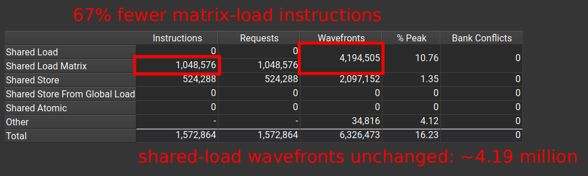

## License

This project is licensed under the MIT License.
